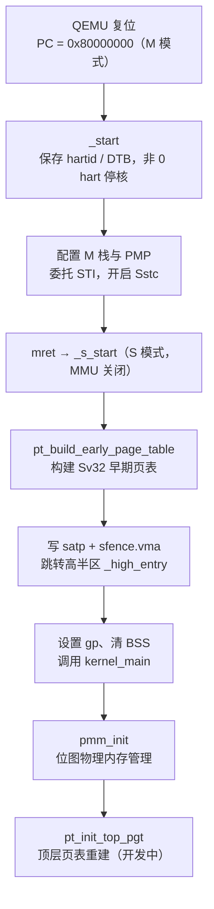

# toy_kernel

**RISC-V 32 位裸机内核（开发中）**

从复位向量开始、不依赖固件的 RISC-V 内核实验：在 QEMU `virt` 上完成 M 模式引导与 S 模式切换，建立 Sv32 分页，并用位图管理 128 MiB 物理内存。目标是把「特权级切换 → 地址翻译 → 陷阱/中断 → 裸机 C 运行环境」这条链路完整走一遍，为后续用户态、进程与调度打基础。

> **项目状态：开发中。** 早期分页、物理内存管理与构建/调试链路已经可用；当前主线是把早期 4 MiB 大页替换为按 4 KiB 精细映射的顶层页表，`pt_init_top_pgt()` 尚未完成。详见下文「项目状态」与「已知限制」。

---

## 项目背景

操作系统内核的启动过程通常被固件和现成框架隐藏。本项目从 QEMU 的复位向量开始，不使用 OpenSBI / U-Boot 等固件（`-bios none`），自行完成：

- M 模式下的物理栈、PMP 权限配置与中断委托；
- 通过 `mret` 进入 S 模式，建立 Sv32 页表并打开 MMU；
- 把内核的执行地址从物理地址 `0x80000000` 切换到高半区 `0xC0000000`；
- 用位图分配器接管 128 MiB 物理内存；
- 在 S 模式实现陷阱入口与定时器中断处理（Sstc），并提供同步异常现场打印；
- 在裸机环境下接上 newlib，使 C 代码可用 `assert` 与标准库接口。

项目定位是「小而完整」：不追求功能数量，而是把每个机制的实现细节、失败路径和调试手段都打通。

## 项目状态（开发中）

### 已完成

以下条目均通过构建；启动、分页与物理内存管理已在 QEMU 上实际运行验证。陷阱/定时器代码已就绪但默认关闭，尚无运行验证。

- [x] 无固件启动：QEMU 复位进入 M 模式，仅 hart 0 继续执行，其余 hart 自旋
- [x] M 模式初始化：独立 M 栈、PMP（TOR 模式，覆盖 `[0, 0x88000000)`）、`mepc` / `mstatus.MPP` 设置、`mret` 进入 S 模式
- [x] 中断委托与 Sstc：`mideleg.STIE`、`menvcfgh.STCE`、`mcounteren.TM`，允许 S 模式直接使用 `stimecmp`
- [x] Sv32 早期页表：内核恒等映射、内核高半区映射（`0xC0000000 → 0x80000000`）、MMIO 恒等映射；写 `satp` 和 `sfence.vma` 后跳转高地址执行
- [x] 链接地址（VMA）与装载地址（LMA）分离：`linker.ld` 用 `AT()` 指定 LMA，段布局与内核栈/堆/早期页表均由链接脚本固定
- [x] 物理内存位图分配器：128 MiB / 32768 个 4 KiB 页，共 1024 个 32 位位图字，支持页分配、释放和内核镜像保留
- [x] 页表构建接口：4 KiB 页映射、4 MiB 大页、连续线性映射（失败回滚）、PTE 查询
- [x] UART 轮询输出、十进制/二进制打印
- [x] newlib 裸机适配：`_write` / `_sbrk` 等 10 个系统调用桩、256 KiB 内核堆、`assert` 失败输出
- [x] S 模式陷阱入口与定时器中断处理代码（当前在 `kernel.c` 中注释关闭）
- [x] Make + QEMU + GDB 工作流：构建、运行、远程调试、异常日志筛选

### 进行中

- [ ] 顶层页表重建：移除早期恒等大页，按 4 KiB 精细映射内核，切换 `satp` 后释放早期页表（`page_table.c` 的 `reset_early_pt()` / `pt_init_top_pgt()`）
- [ ] fixmap 临时映射窗口的物理地址配置与接入
- [ ] 内核对象分配器（`allocator.{c,h}` 目前为接口骨架）

### 规划

- [ ] 用户态与系统调用接口
- [ ] 进程/线程与调度器
- [ ] 虚拟内存管理与按需分页
- [ ] 设备抽象（块设备等）

## 技术栈

| 类别 | 选型 |
| --- | --- |
| 架构 / 特权级 | RISC-V RV32，`rv32imac_zicsr` / `ilp32`，M + S 模式 |
| 地址翻译 | Sv32 二级页表，4 KiB 页 + 4 MiB 大页 |
| 语言 | C（含 C23 `auto` 类型推导）与 RISC-V 汇编 |
| 构建 | GNU Make（模式规则 + `-MMD -MP` 自动依赖），GCC 16.1.0 交叉工具链，自定义链接脚本 |
| C 运行库 | newlib（`-nostdlib` 下手动 `-lc -lgcc`），自实现系统调用桩 |
| 运行 / 调试 | QEMU 11.1.3 `virt`（`-bios none`、`sstc=on`），GDB + gdbstub，`objdump` / `readelf` |
| 代码规模 | 约 1.4k 行（C / 汇编 / 链接脚本 / Makefile） |

## 系统设计

### 启动流程



### 地址空间布局

| 区域 | 虚拟地址 | 物理地址 | 说明 |
| --- | --- | --- | --- |
| QEMU virt RAM | — | `0x80000000` – `0x87FFFFFF` | 128 MiB，与 `config.h` 的 `PHYS_SIZE` 对应 |
| 内核镜像 | `0xC0000000` 起 | `0x80000000` 起 | VMA / LMA 偏移 `0x40000000` |
| M 模式栈 | — | `0x87FE0000` – `0x88000000` | 128 KiB，栈顶 `0x88000000` |
| 内核栈 | 链接脚本定义 | 对应 LMA | 128 KiB |
| 内核堆 | 链接脚本定义 | 对应 LMA | 256 KiB，供 newlib `_sbrk` 使用 |
| 早期页表 | `.early_pt` 段 | 对应 LMA | 4 KiB 对齐，仅根页表 |
| fixmap | `0xFF000000` 起 | 配置中 | 预留的临时映射窗口 |
| MMIO | 恒等映射 | UART `0x10000000`、CLINT `0x02000000`、PLIC `0x0C000000`、test `0x00100000` | 早期页表中按 4 MiB 大页映射 |

### Sv32 分页

早期映射全部使用 4 MiB 大页，因此只需要一张 4 KiB 根页表：

- 内核物理区恒等映射：`0x80000000` – `0x807FFFFF`
- 内核高半区映射：`0xC0000000` – `0xC07FFFFF` → 物理 `0x80000000` – `0x807FFFFF`
- 低 4 MiB 恒等映射（QEMU test 设备，用于关机/退出）
- UART、CLINT、PLIC 的 MMIO 恒等映射
- fixmap 预留窗口

页表操作封装在 `page_table.{c,h}`：

- `pt_build_page_pte()`：4 KiB 页映射，要求二级页表已存在
- `pt_build_mega_page()`：4 MiB 大页映射，检查目标 VPN[1] 是否已被占用
- `pt_build_linear_page_pte()`：批量建立线性映射，任一页失败则回滚已写 PTE
- `get_pte()`：按 VPN[1] / VPN[0] 查询，内部完成 PTE 中物理地址到可访问虚拟地址的换算

PTE 的 PPN 分两段编码（`PPN[1] << 20`、`PPN[0] << 10`），大页要求 4 MiB 对齐，代码中用 `assert` 约束；早期页表开启 `A/D/G` 位，避免未实现访问位模拟时反复缺页。

### 物理内存管理

`pmm.c` 使用位图管理 128 MiB 物理内存：

- 页数 `NPAGES = 32768`，位图 `1024 × 32 bit`
- `pmm_init()` 清零位图、设置 `free_pages`，并把内核镜像所在页标记为已用
- `mark_used()` 将地址按页对齐、裁剪到物理内存范围内，再逐页置位
- `pmm_alloc_page()` 跳过全满的位图字，返回物理地址；`pmm_free_page()` 校验范围与对齐后清位
- `struct Page` 预留 `atomic_int ref_count`，为后续共享页 / CoW 留出接口

### 陷阱与中断

- `trap_entry.S` 在栈上保存除 `sp` 外的 30 个通用寄存器（128 字节栈帧），把 `sp` 作为参数交给 `trap_c_handler()`，返回前恢复现场并 `sret`
- 同步异常：打印 `scause` / `sepc` / `stval` 后停机，不返回故障指令
- S 模式定时器中断：通过 Sstc 的 `stimecmp` 触发；RV32 上 64 位 CSR 分两次写，先写低半字 `0xFFFFFFFF`，再写高半字，最后写低半字，避免中途产生已过期的比较值
- `read_mtime()` 采用「高-低-高」重读，避免 64 位 `mtime` 在读的过程中进位导致撕裂

### 裸机 C 运行环境

`-nostdlib` 阻止自动链接 libc/libgcc 和 crt0，但仍手动链接 `-lc -lgcc` 以使用 newlib。`syscalls.c` 补齐 newlib 需要的 10 个桩：

- `_write`：输出到 UART，并在换行前补 `\r`
- `_sbrk`：在 `[_heap_start, _heap_end)` 内增长堆，越界返回 `(void *)-1` 并置 `ENOMEM`
- `_fstat` / `_isatty`：把 stdout 标记为字符设备
- `_read` / `_close` / `_lseek` / `_kill`：返回错误
- `_exit`：`wfi` 停机
- `_getpid`：返回固定值
- `__assert_func`：打印 `文件:行号: 表达式`，通过 QEMU test 设备以非 0 码退出

没有使用 `--specs=nosys.specs`：它的桩全部返回错误，`_sbrk` 拿不到堆，`_write` 也到不了串口。

### 构建与调试工作流

| 命令 | 作用 |
| --- | --- |
| `make` | 生成 `build/kernel.elf` 与 `build/kernel.bin` |
| `make run` | QEMU 启动（`virt`、`-bios none`、`sstc=on`） |
| `make debug` | 停在复位向量并开放 gdbstub（`localhost:1234`） |
| `make f` | 运行 3 秒，打印串口输出直到第一条同步异常 |
| `make i` | 用 `readelf` 查看 ELF 段布局 |

关键编译选项：

- `-march=rv32imac_zicsr`：新版 binutils 把 Zicsr 从基础 I 拆出，`csrr/csrw` 需要显式声明
- `-mcmodel=medlow`：固定地址镜像使用绝对寻址，装载地址错误会立即暴露，而不是被 PC 相对寻址掩盖
- `-mno-relax`：禁止链接器 relaxation 改写指令，保证反汇编、断点与编译结果一致
- `-fno-pic -fno-pie`：内核没有动态链接器，所有地址必须是链接期常量

## 难点与解决方案

| 难点 | 问题 | 解决方案 |
| --- | --- | --- |
| 无固件启动 | QEMU 直接进入 M 模式，没有 PMP 时 S 模式无法访存 | 设置 `pmpaddr0 = _m_stack_top >> 2`、`pmpcfg0 = TOR + RWX`；配置 `mepc`、`mstatus.MPP` 后 `mret` |
| 中断委托 | S 模式需要直接处理定时器中断并使用 `stimecmp` | `mideleg.STIE` 委托中断，`menvcfgh.STCE = 1` 开启 Sstc，`mcounteren.TM = 1` 允许读 `time` |
| VMA / LMA 分离 | 内核链接在 `0xC0000000`，但 MMU 关闭时必须从 `0x80000000` 运行 | 链接脚本用 `AT()` 把 LMA 设到物理地址；启用 `satp` 后再跳转高半区；`medlow` + `-mno-relax` 避免相对寻址掩盖错误 |
| MMU 关闭期访问页表 | 链接符号都是虚拟地址，直接解引用会访问尚未映射的高地址 | 页表构建阶段用 `__pa()` / `__va()` 手动换算；栈指针使用 PC 相对寻址，天然落在物理别名上 |
| Sv32 PTE 编码 | PPN 分两段、大页需 4 MiB 对齐，手算易错 | 封装 `make_mega_page_pte` / `make_ptr_pte` / `make_l2_page_pte`，构造前 `assert` 对齐 |
| 线性映射失败一致性 | 批量建页中途失败会留下半成品映射 | 失败时遍历本次已建立的 PTE 清零，再返回错误 |
| RV32 的 64 位 CSR | `stimecmp` / `mtime` 分两次读写，可能读到或写入撕裂值 | `stimecmp` 先写低半字 `0xFFFFFFFF` 再写高半字；`mtime` 用高-低-高重读 |
| newlib 适配 | `-nostdlib` 后标准库调用全部悬空，`nosys` 桩不可用 | 手动 `-lc -lgcc`，实现 UART 输出、`_sbrk` 堆、字符设备属性和断言退出 |
| 调试日志被终端吞掉 | QEMU `-nographic` 在 stdin 为终端时会丢弃 `-d` 日志 | `</dev/null` 重定向 stdin；用 `awk` 在第一条同步异常处停止，避免取指死循环刷屏 |

## 成果（阶段性）

已在本地 QEMU `virt` 上复现的启动输出：

```text
Hello, Kernel.
11000000010000000000000000000000
10000111101111100000000000000000
time: 9837
```

说明：

- 中间两行二进制是开发期的地址调试打印（`FIXMAP_PA` 与 `_fixmap`），不是最终输出
- `Hello, Kernel.` 证明 M → S 切换、早期页表、`satp` 启用和跳转高半区均正常
- `time: 9837` 为从 CLINT `mtime` 读取的计时值（随运行时刻变化），证明 MMIO 映射可用

可量化结果：

- 128 MiB 物理内存纳入统一管理，32768 个 4 KiB 页
- 单张 4 KiB 根页表覆盖内核、MMIO 与 fixmap 窗口
- 内核 VMA / LMA 分离，镜像在高半区与物理区均可正确执行
- 提供 4 KiB / 4 MiB 两种粒度的页表构建接口和失败回滚
- 一套可复现的构建、运行、调试与异常定位命令

## 快速开始

依赖：`riscv32-unknown-elf` 工具链（GCC + binutils）、`qemu-system-riscv32`（需支持 Sstc）、RISC-V GDB。

```bash
make            # 构建 build/kernel.elf 和 build/kernel.bin
make run        # 在 QEMU virt 中运行
make debug      # 停在复位向量，开放 gdbstub :1234
make f          # 运行 3 秒并打印到第一条同步异常
make i          # 查看 ELF 段布局
```

调试时建议关闭优化，否则局部变量和 `assert` 会被优化掉：

```bash
make clean && make OPT=-O0
make debug
```

另开终端：

```bash
riscv32-unknown-elf-gdb build/kernel.elf
(gdb) target remote :1234
```

## 目录结构

```text
.
├── boot.S             # 复位入口：M 模式初始化、PMP、S 模式入口
├── trap_entry.S       # S 模式陷阱入口：通用寄存器保存/恢复
├── kernel.c           # 内核主流程
├── config.h           # 硬件地址与内存布局常量
├── linker.ld          # VMA/LMA 分离的链接脚本
├── page_table.c/.h    # Sv32 页表构建与查询
├── pmm.c/.h           # 位图物理页分配器
├── page.h             # struct Page（引用计数，预留）
├── allocator.c/.h     # 内核对象分配器（骨架，开发中）
├── mem.c/.h           # 内核内存子系统聚合
├── syscalls.c         # newlib 系统调用桩与断言处理
├── uart.h             # 轮询式 UART 输出与格式化
├── interupt.h         # 陷阱处理、CLINT mtime、Sstc 定时器
├── power_off.h        # QEMU test 设备关机/重启/退出
└── Makefile           # 构建、运行、调试目标
```

## 简历描述参考

以下条目可直接改写入简历的项目经历，状态描述保持「开发中」：

**toy_kernel — RISC-V 32 位裸机内核（个人项目，开发中）**

- 不依赖固件在 QEMU `virt` 上从复位向量启动，完成 M → S 模式切换：配置 PMP 与独立 M 栈，委托定时器中断并开启 Sstc，通过 `mret` 进入 S 模式。
- 实现 Sv32 早期分页：内核高半区映射（`0xC0000000 → 0x80000000`）、MMIO 恒等映射与 4 MiB 大页，写 `satp` 后跳转高地址继续执行。
- 实现 128 MiB 物理内存位图分配器（32768 页）与页表构建 API，支持 4 KiB / 4 MiB 映射、批量线性映射及失败回滚。
- 补齐 newlib 裸机运行环境（10 个系统调用桩、256 KiB 内核堆），搭建 Make + QEMU + GDB 的构建、运行与调试链路。
- 正在将早期大页替换为按 4 KiB 精细映射的顶层页表，并通过 QEMU 异常日志与 GDB 定位早期缺页问题。

技术关键词：RISC-V · Sv32 · PMP · Sstc · S 模式 · 页表 · 位图分配器 · 链接脚本 · QEMU · GDB · newlib · GNU Make

## 已知限制与路线图

- 仅支持单 hart，无 SMP
- 仅适配 QEMU `virt`，外设地址在 `config.h` 中硬编码
- 无用户态、进程调度、文件系统
- 顶层页表切换尚未完成：`reset_early_pt()` 中仍有占位代码，启动会在 `pt_init_top_pgt()` 处触发缺页后停住；`make f` 可观察 `cause=0xd`、`tval=0xdeadbeef` 的 load page fault
- 暂无自动化测试，验证依赖 QEMU 串口输出与 GDB 断点
- 后续优先完成顶层页表切换，再推进内核堆分配器、用户态与调度
